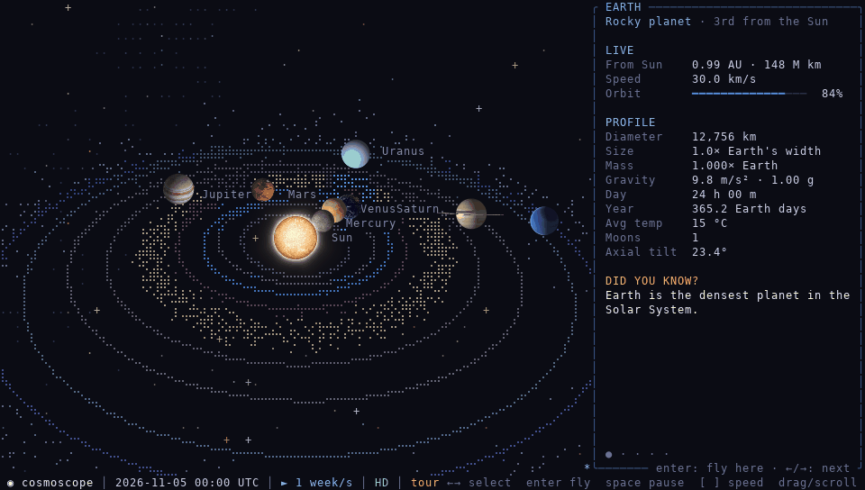
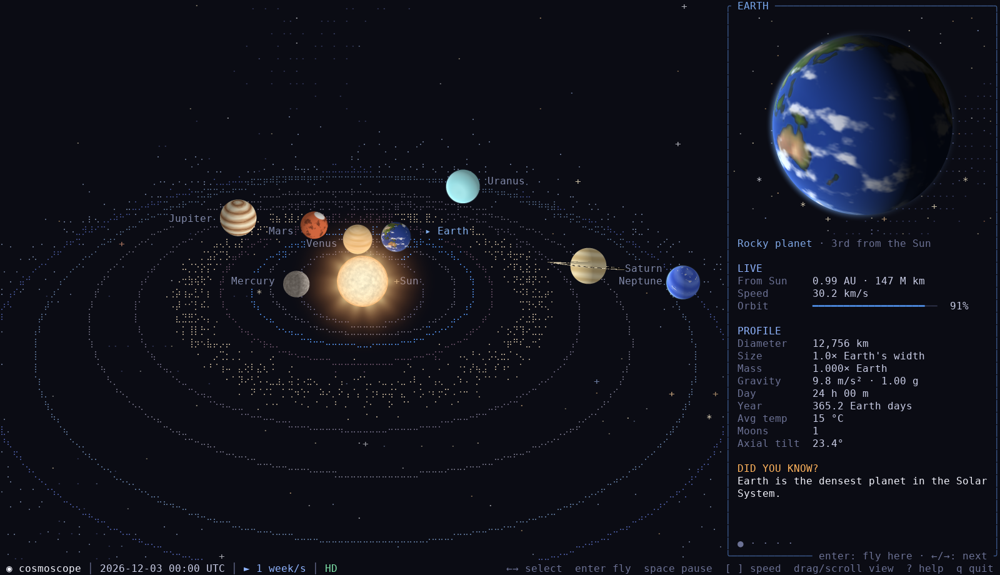
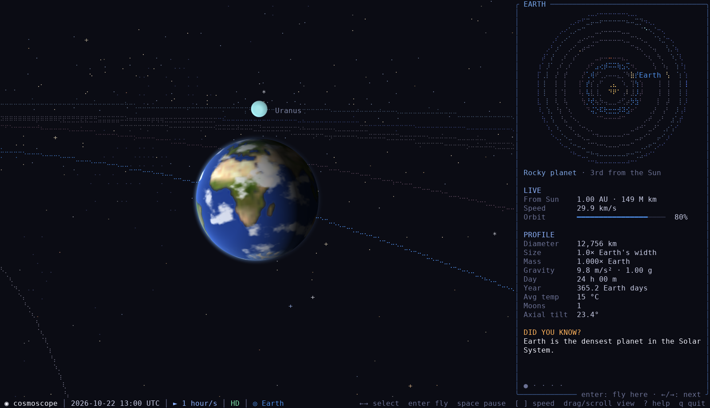
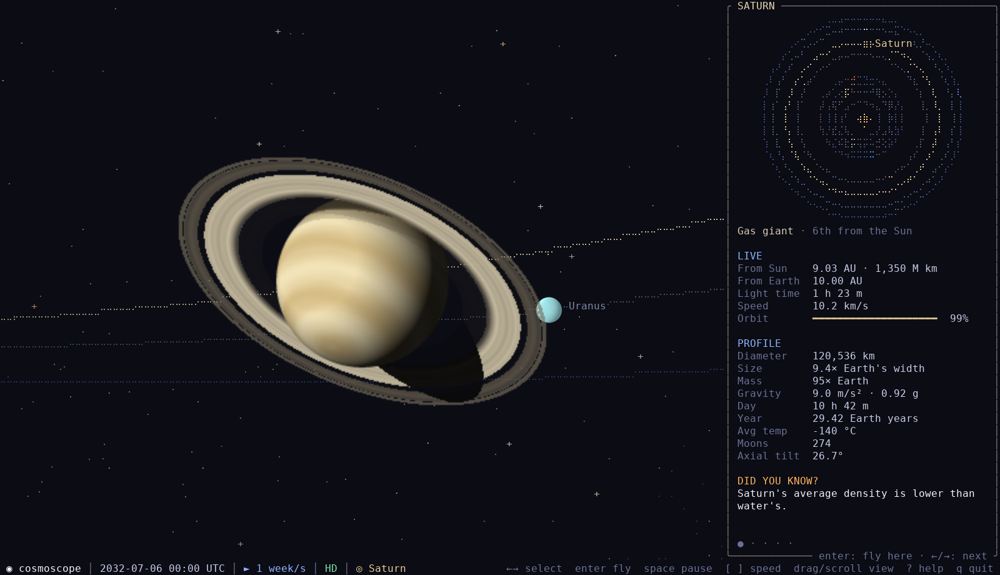
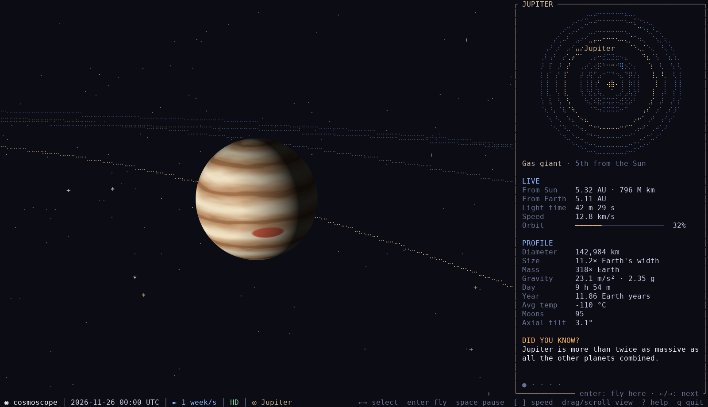
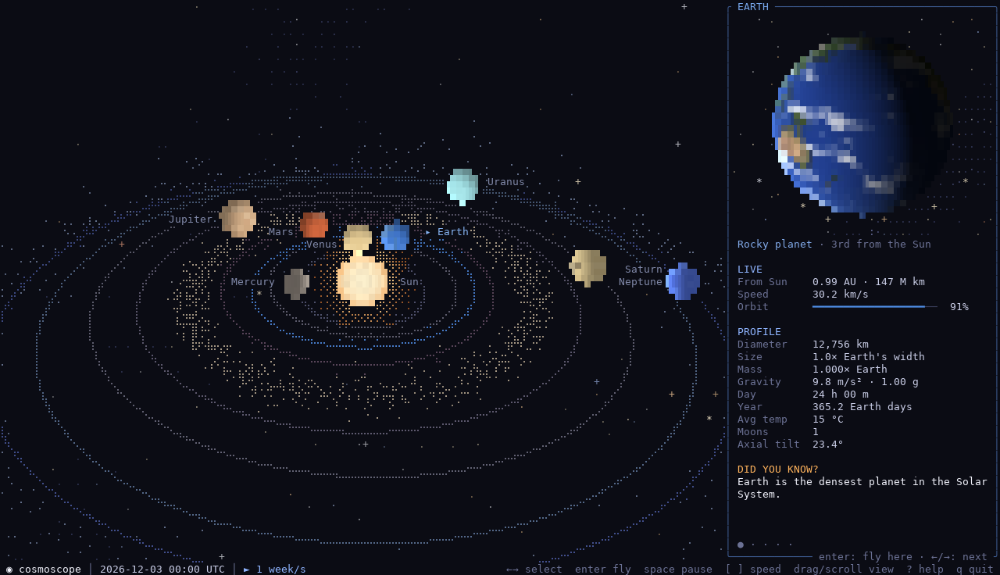

# cosmoscope

**A living Solar System you can explore in your terminal.** Planets sit where they really are today. You can travel through time, fly in close to any world, and read live facts while everything keeps moving.

[](https://github.com/phanminhtai1029/cosmoscope/actions/workflows/build.yml)
[](https://github.com/phanminhtai1029/cosmoscope/releases/latest)
[](LICENSE)




<sub>The guided tour (`cosmoscope --tour`) in HD mode, recorded at about 3x speed.</sub>

---

## Features

- **HD planets.** In terminals that speak the kitty graphics protocol (Ghostty, kitty and WezTerm on Linux and macOS; Konsole with `--graphics kitty`), the Sun, planets and rings are drawn as real anti-aliased images with true transparency. The text layer still carries the orbits, stars, labels and panels, so it stays a terminal app. Every other terminal gets a carefully tuned text renderer instead.
- **The real sky, right now.** Planet positions come from NASA JPL orbital elements for the current date, and they match JPL Horizons to within 0.15 degrees. Each planet's spin axis comes from the IAU, so Saturn's rings tilt the way they really do.
- **Time travel.** Run time from real time up to 10 years per second, forwards or backwards, or jump to any date from the year 1000 to 3000: `--date 1969-07-20`.
- **Fly to any world.** Press <kbd>Enter</kbd> and the camera glides in close, lit by the Sun from its true direction.
  - **Earth** uses NASA's Blue Marble map with drifting clouds, and it turns with real sidereal time. Africa faces the Sun at noon in Africa.
  - **Jupiter** has its belts, zones and the Great Red Spot.
  - **Saturn** has its C, B and A rings, the Cassini division, and shadows cast in both directions.
- **Live data panel.** It shows the distance from the Sun and from Earth, light travel time, orbital speed, how far through its orbit a planet is, and the physical profile from NASA's fact sheet. A rotating close-up of the selected planet sits on top, and "Did you know?" facts type themselves out.
- **Always in motion.** The camera slowly circles. Asteroid-belt and Kuiper-belt particles orbit at their real Keplerian speeds. The Sun's corona flickers, stars twinkle, and the Milky Way sits where it belongs in the sky.
- **Mouse and keyboard.** Drag to rotate, scroll to zoom, click a planet to select it, and click it again to fly there.
- **Guided tour / screensaver.** `cosmoscope --tour` flies from world to world on its own. Press any key to take over.
- **Terminal-friendly.** Empty space keeps your terminal's own background, so transparent and blurred terminals look great. It uses 24-bit colour, falls back to 256 colours, adapts to any window size, and ships as one static binary with no runtime dependencies.

<table>
  <tr>
    <td></td>
    <td></td>
  </tr>
  <tr>
    <td></td>
    <td></td>
  </tr>
</table>

<sub>HD mode. Top: the whole system with the live panel; Earth at 08:00 UTC on 22 Oct 2026, with Africa in daylight. Bottom: Saturn in 2032, with the planet's shadow across its rings; Jupiter and the Great Red Spot.</sub>

<details>
<summary>Text mode (GNOME Terminal, Terminal.app, tmux, SSH ...)</summary>



The text renderer packs 2×2 colour blocks into each cell with half-block and quadrant glyphs, and orbits use braille dots. It needs no special terminal support.
</details>

## Installation

### Linux and macOS
```bash
curl -fsSL https://raw.githubusercontent.com/phanminhtai1029/cosmoscope/main/install/install.sh | sh
```
The installer downloads a prebuilt binary to `~/.local/bin/cosmoscope`: a static binary on Linux (x86_64 or arm64), a universal binary on macOS (Apple Silicon and Intel). No sudo is needed. If `~/.local/bin` is not on your `PATH`, the installer prints the line to add.

### Windows 10 / 11
In PowerShell:
```powershell
irm https://raw.githubusercontent.com/phanminhtai1029/cosmoscope/main/install/install.ps1 | iex
```
The binary goes to `%LOCALAPPDATA%\Programs\cosmoscope` and is added to your user `PATH`. Open a new terminal afterwards. [Windows Terminal](https://aka.ms/terminal) is recommended.

### With Cargo
If you have Rust 1.88 or newer:
```bash
cargo install --git https://github.com/phanminhtai1029/cosmoscope
```

### Manual download
Grab a binary from the [latest release](https://github.com/phanminhtai1029/cosmoscope/releases/latest). A `SHA256SUMS` file is included.

| File | Platform |
|---|---|
| `cosmoscope-linux-x86_64` | Linux x86_64 (static, any distro) |
| `cosmoscope-linux-arm64` | Linux ARM64, e.g. Raspberry Pi 4/5 (static) |
| `cosmoscope-macos-universal` | macOS 11+, Apple Silicon and Intel |
| `cosmoscope-windows-x86_64.exe` | Windows 10/11 x64; also runs on ARM through emulation |

If you download through a browser, the system may block the file the first time:
- **macOS**: run `xattr -d com.apple.quarantine cosmoscope-macos-universal`.
- **Windows**: SmartScreen shows a warning. Choose *More info*, then *Run anyway*.

### Build from source
```bash
git clone https://github.com/phanminhtai1029/cosmoscope.git
cd cosmoscope
cargo build --release     # binary at target/release/cosmoscope
cargo test                # includes an accuracy check against JPL Horizons
```

## Usage

```bash
cosmoscope                       # the whole Solar System, now
cosmoscope saturn                # fly straight to Saturn
cosmoscope --date 1969-07-20     # the sky on the day of the Moon landing
cosmoscope --speed year          # one year per second
cosmoscope --tour                # hands-off guided tour, great as a screensaver
cosmoscope --no-panel --no-rotate
```

| Option | Meaning |
|---|---|
| `[BODY]` | Start flying to `sun`, `mercury`, `venus`, `earth`, `mars`, `jupiter`, `saturn`, `uranus` or `neptune` |
| `--date <DATE>` | Start date in UTC, `YYYY-MM-DD` or `YYYY-MM-DDTHH:MM` |
| `--speed <SPEED>` | `realtime`, `minute`, `hour`, `6hours`, `day`, `week` (default), `month`, `year`, `decade` |
| `--paused` | Start with time paused |
| `--tour` | Guided tour; any key takes the controls back |
| `--no-panel` | Hide the info panel; <kbd>i</kbd> toggles it |
| `--no-rotate` | Keep the camera still; <kbd>r</kbd> toggles it |
| `--graphics <MODE>` | `auto` (default: HD when the terminal supports it), `kitty` (force HD) or `off` (text only); also `COSMOSCOPE_GRAPHICS` |
| `--colors <MODE>` | `auto` (default), `truecolor` or `256`; the `COSMOSCOPE_COLORS` variable does the same |
| `--fps <N>` | Frame rate, 5-120 (default 30). Lower it over slow SSH links |

### Controls

| Key | Action |
|---|---|
| <kbd>←</kbd> <kbd>→</kbd> / <kbd>Tab</kbd> | Select the previous / next body |
| <kbd>0</kbd> - <kbd>8</kbd> | Select the Sun, Mercury ... Neptune |
| <kbd>Enter</kbd> / click | Fly to the selected body; press again to leave |
| <kbd>Esc</kbd> / <kbd>Backspace</kbd> | Back to the whole system, or close the help |
| <kbd>Space</kbd> | Pause / resume time |
| <kbd>[</kbd> <kbd>]</kbd> | Slower / faster time |
| <kbd>b</kbd> | Run time backwards |
| <kbd>t</kbd> | Jump to now |
| drag, <kbd>a</kbd> <kbd>d</kbd>, <kbd>↑</kbd> <kbd>↓</kbd> | Rotate and tilt the view |
| scroll, <kbd>+</kbd> <kbd>-</kbd> | Zoom |
| <kbd>r</kbd> | Toggle auto-rotation |
| <kbd>i</kbd> | Toggle the info panel (it shows itself on terminals 110+ columns wide) |
| <kbd>T</kbd> | Start / stop the guided tour |
| <kbd>?</kbd> | Help |
| <kbd>q</kbd> / <kbd>Ctrl</kbd>+<kbd>C</kbd> | Quit |

## Terminal tips

- **For the best picture, use a terminal with the kitty graphics protocol.** Good choices are [Ghostty](https://ghostty.org), [kitty](https://sw.kovidgoyal.net/kitty/) or [WezTerm](https://wezfurlong.org/wezterm/), on Linux or macOS. HD switches on automatically, and the status bar shows **HD**. Inside tmux or screen, images do not pass through, so cosmoscope falls back to text.
  - Ubuntu: `sudo snap install ghostty --classic`
  - macOS: `brew install --cask ghostty`
- **HD needs a little more power.** It uses about one CPU core and a few MB/s of terminal bandwidth. Over SSH, use `--graphics off` or a lower `--fps`.
- **Fonts.** Bodies are drawn with half blocks (`▀▄`) and orbits with braille dots (`⣿`). Any modern monospace font has them: JetBrains Mono, Cascadia Code, Fira Code, DejaVu Sans Mono, SF Mono, Menlo or Nerd Fonts.
- **Colour.** Most terminals get 24-bit colour automatically, including GNOME Terminal, Konsole, kitty, Alacritty, WezTerm, Ghostty, iTerm2 and Windows Terminal. macOS Terminal.app gets the 256-colour fallback. Inside tmux, either enable RGB (`set -as terminal-features ",*:RGB"`) or run with `--colors truecolor`.
- **Size.** It works from 80×24 upwards, and it looks best at 120×40 or larger with a small font.
- **SSH.** Every frame is fully animated, so on slow links lower the frame rate with `--fps 15`, and use `--graphics off` if you are in a kitty-protocol terminal.

## How accurate is it?

| What | Source | Accuracy |
|---|---|---|
| Planet positions | JPL *Keplerian Elements for Approximate Positions of the Major Planets* (Standish), Table 1 | Within 0.15° of JPL Horizons at the tested dates, which the test suite checks. Best for 1800-2050; the status bar warns outside that range |
| Spin axes | IAU WGCCRE 2015 pole directions | Real orientations, so Saturn's ring tilt and Earth's seasons are correct |
| Earth's rotation | Greenwich mean sidereal time | The day side is the real day side; a test checks the subsolar point at the 2026 solstice |
| Physical data | NASA Planetary Fact Sheet and Sun Fact Sheet | As published, including moon counts |

**Not to scale, on purpose.** Real distances span 30 AU while planets are a few thousand kilometres wide, so a true-scale view would be empty space with invisible dots. cosmoscope compresses distances logarithmically and enlarges the bodies. Directions, ordering, orbit shapes and timing all stay real.

## Roadmap

- **HD everywhere**: Sixel and iTerm2 inline images, plus Windows support, so Windows Terminal, foot and iTerm2 get HD too.
- **v0.2**: moons (the Moon, the Galilean moons, Titan), Mars' polar seasons, Uranus and Neptune ring detail, comets.
- **v0.3**: a size comparison view, "your weight on ..." and "travel time to ..." calculators, `cosmoscope --fact` for your shell greeting.
- **Later**: zoom out past the Kuiper belt to the nearest stars, the Milky Way, the Local Group and the cosmic web.

Ideas and pull requests are welcome. Planet facts and data live in [`assets/bodies.toml`](assets/bodies.toml), so adding a fact needs no Rust at all.

## Project layout

```
src/
  main.rs        command line, terminal setup, event loop, --snapshot
  app.rs         state: time, selection, camera, tour, input
  render.rs      software renderer: shared body shading, text back end (block/quadrant glyphs,
                 braille orbits, sky) and HD back end (anti-aliased RGBA sprites)
  kitty.rs       kitty graphics protocol output: chunked zlib images, double-buffered ids
  ui.rs          ratatui layout: info panel, status bar, help
  ephemeris.rs   JPL orbital elements and Kepler's equation (with Horizons tests)
  time.rs        Julian dates and calendar conversion
  data.rs        body data loader
assets/
  bodies.toml    physical data, pole directions and facts for each body
  earth_128x64.rgb   NASA Blue Marble, downsampled
tools/           screenshot/GIF generators and a kitty-protocol compositor (Python + Pillow)
```

## Credits

- Orbital elements: E. M. Standish, JPL Solar System Dynamics. Test vectors come from [JPL Horizons](https://ssd.jpl.nasa.gov/horizons/).
- Physical data: [NASA Planetary Fact Sheet](https://nssdc.gsfc.nasa.gov/planetary/factsheet/).
- Pole directions: IAU Working Group on Cartographic Coordinates and Rotational Elements (2015).
- Earth texture: [NASA Visible Earth, Blue Marble](https://visibleearth.nasa.gov/) (public domain).
- Built with [ratatui](https://ratatui.rs) and [crossterm](https://github.com/crossterm-rs/crossterm).
- Sibling project: [saturn](https://github.com/phanminhtai1029/saturn), an animated ASCII Saturn.

## License

[MIT](LICENSE). NASA imagery and data are in the public domain.
